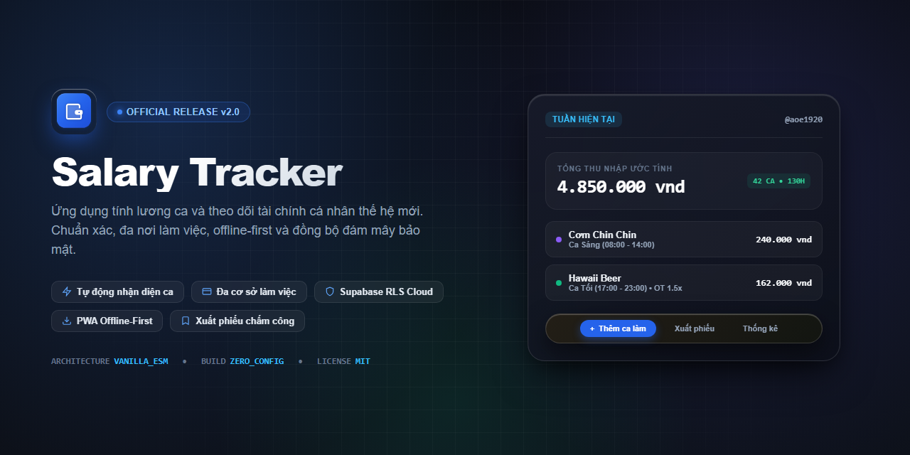
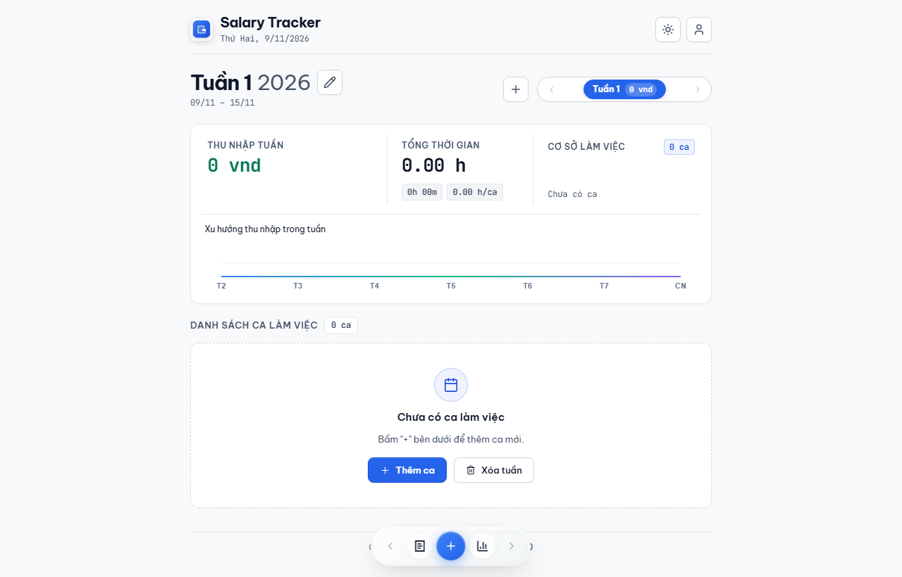
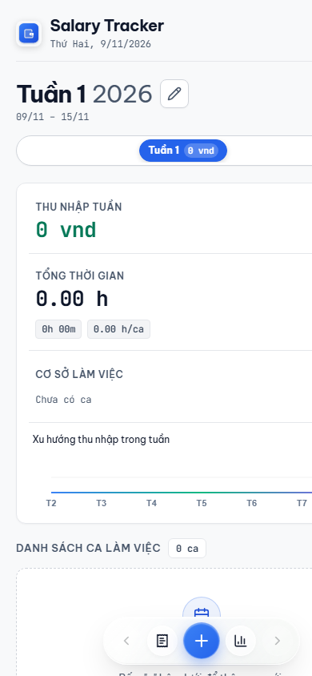

<div align="center">



# Salary Tracker

**Ứng dụng tính lương ca và theo dõi tài chính cá nhân thế hệ mới**  
*The Modern, Precision Shift Scheduling & Wage Tracking PWA*

[](https://aoe1920.github.io/salary-tracker/)
[](https://github.com/aoe1920/salary-tracker/releases)
[](https://aoe1920.github.io/salary-tracker/)
[](https://supabase.com)
[](https://developer.mozilla.org/)
[](LICENSE)

<p align="center">
  <a href="https://aoe1920.github.io/salary-tracker/"><strong>Trải nghiệm ứng dụng trực tiếp →</strong></a>
</p>

</div>

---

## 📌 Mục lục

- [Giới thiệu](#-giới-thiệu)
- [Giao diện ứng dụng](#-giao-diện-ứng-dụng)
- [Tính năng nổi bật](#-tính-năng-nổi-bật)
- [Công nghệ sử dụng](#-công-nghệ-sử-dụng)
- [Cấu trúc mã nguồn](#-cấu-trúc-mã-nguồn)
- [Hướng dẫn cài đặt PWA](#-hướng-dẫn-cài-đặt-pwa)
- [Khởi chạy cục bộ](#-khởi-chạy-cục-bộ)
- [Thiết lập Cơ sở dữ liệu Supabase](#-thiết-lập-cơ-sở-dữ-liệu-supabase)
- [Đóng góp và Giấy phép](#-đóng-góp-và-giấy-phép)

---

## 🌟 Giới thiệu

**Salary Tracker** là ứng dụng web tiến bộ (Progressive Web App - PWA) chuẩn xác, bảo mật và tinh tế dành cho người đi làm theo ca, sinh viên làm thêm, nhân viên part-time, freelancer và người làm việc tại nhiều cơ sở khác nhau.

Ứng dụng giúp bạn xóa bỏ hoàn toàn sổ sách thủ công hay bảng tính phức tạp bằng một hệ thống tính lương tự động, phân tích tài chính thông minh, hỗ trợ xuất phiếu chấm công chia sẻ nhanh chóng và hoạt động mượt mà ngay cả khi hoàn toàn mất mạng (Offline-First).

---

## 📸 Giao diện ứng dụng

<div align="center">
  <table border="0">
    <tr>
      <td align="center" width="65%">
        
        <br>
        <em>Bảng điều khiển máy tính (Desktop Dark Theme)</em>
      </td>
      <td align="center" width="35%">
        
        <br>
        <em>Giao diện điện thoại di động (Mobile Dark Mode)</em>
      </td>
    </tr>
  </table>
</div>

---

## ✨ Tính năng nổi bật

### 🎯 1. Tự động nhận diện ca làm thông minh (Smart Shift Engine)
- Tự động xác định chính xác **Ca Sáng (Morning)**, **Ca Chiều (Noon)**, hoặc **Ca Tối (Evening)** dựa trên tỷ lệ chồng lấn thời gian thực tế, không cần người dùng tự chọn thủ công.
- Tự động tính toán số giờ làm việc thực tế sau khi trừ đi số phút nghỉ giải lao.

### 💰 2. Động cơ tính lương chuẩn xác tuyệt đối (Precision Wage Engine)
- Tính toán tiền lương theo đơn vị tiền tệ chuẩn `vnd` và đơn giá theo giờ `vnd/h`.
- Xử lý chuẩn xác các ca làm việc xuyên đêm vượt qua mốc nửa đêm `00:00` (ví dụ: `22:00` đến `04:00` sáng hôm sau).
- Hỗ trợ linh hoạt hệ số tăng ca OT (`1.0x`, `1.5x`, `2.0x`, `3.0x`).
- Ghi nhận chi tiết tiền phụ cấp/thưởng và các khoản khấu trừ cho từng ca.

### 🏢 3. Quản lý đa cơ sở làm việc (Multi-Workplace System)
- Quản lý không giới hạn số lượng cơ sở làm việc với đơn giá theo giờ riêng biệt cho từng nơi.
- Mỗi cơ sở được cấp phát mã màu đại diện trực quan, dễ phân biệt trên danh sách và biểu đồ.
- Tùy chọn cơ sở làm việc mặc định, cho phép đổi tên hoặc xóa nơi làm việc với cơ chế cập nhật tự động đồng bộ trên toàn bộ ca làm trong lịch sử.

### 📊 4. Biểu đồ thống kê và Báo cáo tài chính (Interactive Analytics)
- Thẻ chỉ số KPI thời gian thực: Tổng thu nhập, tổng số ca làm, tổng số giờ làm và trung bình theo tuần.
- Biểu đồ trực quan thu nhập theo từng ngày trong tuần và tiến trình thu nhập qua các tuần.
- Biểu đồ tròn thể hiện cơ cấu tỷ trọng thu nhập đóng góp từ từng cơ sở làm việc.

### 🧾 5. Kết xuất Phiếu Chấm Công và Chia sẻ 1 chạm (Canvas Payslip)
- Tự động vẽ Phiếu chấm công và bảng kê lương bằng công nghệ HTML5 Canvas độ nét cao.
- **Sao chép ảnh vào Clipboard:** 1 chạm để dán (Ctrl+V) gửi ngay cho quản lý qua Zalo, Messenger, Telegram.
- **Tải ảnh PNG:** Lưu phiếu lương dạng hình ảnh sắc nét về máy.
- **Xuất CSV và JSON:** Xuất file báo cáo chấm công chi tiết theo tuần hoặc tất cả các tuần để lưu trữ và sao lưu.

### 🔒 6. Đám mây Supabase và Bảo mật cấp doanh nghiệp (Cloud Sync & RLS)
- **Đăng nhập linh hoạt:** Đăng nhập bằng Tên người dùng (Username) hoặc Email.
- **Xác thực Google OAuth 2.0 PKCE:** Đăng nhập một chạm tiện lợi và hỗ trợ liên kết tài khoản Google trực tiếp trong hồ sơ.
- **Khôi phục mật khẩu tự phục vụ:** Gửi liên kết đặt lại mật khẩu an toàn qua email.
- **Bảo mật Row Level Security (RLS):** Dữ liệu được cách ly độc lập tại tầng cơ sở dữ liệu (`auth.uid() = user_id`), đảm bảo quyền riêng tư tuyệt đối cho từng người dùng.

### 📱 7. Trải nghiệm PWA Offline-First và Thiết kế Liquid Glass Mossy
- Hoạt động ngoại tuyến 100% nhờ Service Worker Cache Storage API. Mọi thay đổi khi mất mạng sẽ được tự động đồng bộ lên đám mây ngay khi có kết nối trở lại.
- Thanh điều hướng nổi dạng viên thuốc Liquid Glass Mossy phong cách iOS cao cấp với hiệu ứng mờ tuyết quang học và phản hồi xúc giác rung (Haptic Feedback) trên thiết bị di động.
- Hệ thống nhân vật đại diện vector phong phú và hỗ trợ chuyển đổi giao diện Sáng / Tối (Light / Dark mode) mượt mà.

---

## 🛠️ Công nghệ sử dụng

| Lĩnh vực | Công nghệ | Mô tả |
| :--- | :--- | :--- |
| **Frontend Core** | Vanilla JavaScript (ES2022 ESM) | Chuẩn module hiện đại, hoạt động độc lập không cần Webpack/Vite/Babel |
| **Styling** | Modular CSS3 Variables | Thiết kế hệ thống Design Tokens, Glassmorphism, Responsive Grid và Flexbox |
| **Backend & Database** | Supabase Cloud (PostgreSQL 15) | Cơ sở dữ liệu đám mây với Row Level Security và xác thực GoTrue Auth |
| **PWA & Storage** | Service Worker API, Cache Storage | Hỗ trợ cài đặt ứng dụng độc lập và lưu trữ ngoại tuyến hoàn toàn |
| **Graphics** | HTML5 Canvas API | Kết xuất phiếu chấm công độ phân giải cao và xuất ảnh tức thì |
| **Icons & Avatars** | Handcrafted SVG & Alohe Avatars | Bộ biểu tượng vector tối ưu hiệu năng và hình vẽ đại diện sắc nét |

---

## 📂 Cấu trúc mã nguồn

```text
salary-tracker/
├── assets/
│   ├── avatars/             # Bộ sưu tập ảnh đại diện vector
│   ├── icons/               # Bộ biểu tượng ứng dụng PWA và favicon
│   ├── screenshots/         # Hình ảnh chụp màn hình minh họa giao diện
│   └── poster.png           # Áp phích phát hành chính thức của ứng dụng
├── css/
│   ├── base.css             # Thiết lập biến hệ thống, reset và kiểu chữ
│   ├── components.css       # Các nút bấm, thẻ thông tin, dockbar và week wheel
│   └── modals.css           # Hộp thoại modal, thông báo toast và bảng biểu
├── js/
│   ├── services/
│   │   └── supabase.js      # Khách kết nối Supabase, phiên xác thực và đồng bộ mây
│   ├── ui/
│   │   ├── avatars.js       # Quản lý hiển thị và lựa chọn nhân vật đại diện
│   │   ├── canvas-slip.js   # Động cơ kết xuất phiếu chấm công bằng Canvas
│   │   ├── chart.js         # Đồ thị tài chính và bảng thống kê phân tích
│   │   ├── dialog.js        # Hộp thoại cảnh báo và xác nhận người dùng
│   │   ├── export.js        # Xuất dữ liệu bảng tính CSV và sao lưu JSON
│   │   ├── haptic.js        # Phản hồi rung haptic xúc giác trên mobile
│   │   ├── modals.js        # Điều phối các hộp thoại thêm ca, hồ sơ và nơi làm việc
│   │   ├── select.js        # Thành phần chọn lựa tương tác trợ năng
│   │   └── toast.js         # Hệ thống thông báo toast tự động thích ứng
│   ├── vendor/              # Các thư viện phụ trợ độc lập
│   ├── app.js               # Điểm khởi động chính của ứng dụng
│   ├── calculator.js        # Động cơ tính giờ, nhận diện ca và tính lương chuẩn xác
│   ├── config.js            # Hằng số cấu hình hệ thống và bảng màu nơi làm việc
│   ├── i18n.js              # Từ điển ngôn ngữ và bản địa hóa giao diện
│   ├── state.js             # Kho lưu trữ trạng thái trung tâm của ứng dụng
│   └── theme.js             # Bộ lắng nghe và chuyển đổi chế độ Sáng / Tối
├── index.html               # Cấu trúc khung giao diện chuẩn ngữ nghĩa HTML5
├── manifest.json            # Bản khai thông tin ứng dụng Progressive Web App
└── sw.js                    # Service Worker quản lý bộ nhớ đệm ngoại tuyến
```

---

## 📱 Hướng dẫn cài đặt PWA

Ứng dụng có thể cài đặt trực tiếp vào màn hình chính của điện thoại hoặc máy tính mà không cần qua App Store hay Google Play:

### Trên iPhone / iPad (iOS Safari)
1. Mở liên kết [https://aoe1920.github.io/salary-tracker/](https://aoe1920.github.io/salary-tracker/) bằng trình duyệt **Safari**.
2. Nhấn vào nút **Chia sẻ (Share)** hình vuông có mũi tên hướng lên ở thanh công cụ dưới cùng.
3. Cuộn xuống và chọn **Thêm vào MH chính (Add to Home Screen)**.
4. Nhấn **Thêm (Add)** ở góc trên bên phải để hoàn tất.

### Trên điện thoại Android (Google Chrome)
1. Mở liên kết trên bằng trình duyệt **Chrome**.
2. Nhấn vào biểu tượng **Menu 3 chấm** ở góc trên bên phải.
3. Chọn **Cài đặt ứng dụng (Install app)** hoặc **Thêm vào màn hình chính**.
4. Xác nhận cài đặt để tạo biểu tượng ứng dụng trên màn hình.

### Trên máy tính (Chrome / Edge)
1. Truy cập ứng dụng trên trình duyệt máy tính.
2. Nhấn vào biểu tượng **Cài đặt ứng dụng (Install)** ở bên phải thanh địa chỉ URL.
3. Ứng dụng sẽ hoạt động trong một cửa sổ riêng biệt tương tự phần mềm chuyên dụng.

---

## ⚡ Khởi chạy cục bộ

Do ứng dụng được xây dựng theo chuẩn **Vanilla ES Modules**, bạn không cần cài đặt Node.js hay chạy các lệnh build phức tạp:

```bash
# 1. Sao chép kho mã nguồn về máy tính
git clone https://github.com/aoe1920/salary-tracker.git
cd salary-tracker

# 2. Khởi chạy bằng bất kỳ máy chủ HTTP tĩnh nào
# Sử dụng npx:
npx serve .

# Hoặc sử dụng Python 3 tích hợp sẵn:
python -m http.server 8080

# Hoặc sử dụng extension Live Server trên VS Code
```

Mở trình duyệt và truy cập vào địa chỉ `http://localhost:8080`.

---

## 🔒 Thiết lập Cơ sở dữ liệu Supabase

Nếu muốn tự triển khai máy chủ cơ sở dữ liệu riêng trên **Supabase**, hãy thực thi đoạn mã SQL sau trong phần **SQL Editor** của Supabase Dashboard:

```sql
create table if not exists public.user_salary_data (
  user_id uuid references auth.users(id) on delete cascade primary key,
  username text,
  weeks jsonb not null default '[]'::jsonb,
  settings jsonb not null default '{}'::jsonb,
  updated_at timestamptz default timezone('utc'::text, now()) not null
);

alter table public.user_salary_data enable row level security;

create policy "Users can only manage their own salary data"
  on public.user_salary_data for all
  using (auth.uid() = user_id)
  with check (auth.uid() = user_id);

create or replace function public.delete_user()
returns void
language plpgsql
security definer
set search_path = public
as $$
begin
  delete from auth.users where id = auth.uid();
end;
$$;

grant execute on function public.delete_user() to authenticated;

create or replace function public.get_login_email(p_username text)
returns text
language plpgsql
security definer
set search_path = public
as $$
declare
  v_email text;
begin
  select u.email into v_email
  from auth.users u
  left join public.user_salary_data s on s.user_id = u.id
  where lower(s.username) = lower(p_username)
     or lower(u.raw_user_meta_data->>'username') = lower(p_username)
  limit 1;
  return v_email;
end;
$$;

grant execute on function public.get_login_email(text) to anon, authenticated;
```

---

## 📄 Đóng góp và Giấy phép

Dự án được phân phối dưới giấy phép mã nguồn mở **MIT License**. Mọi đóng góp, báo lỗi hoặc đề xuất tính năng mới đều được hoan nghênh thông qua [GitHub Issues](https://github.com/aoe1920/salary-tracker/issues) hoặc [Pull Requests](https://github.com/aoe1920/salary-tracker/pulls).

<div align="center">
  <sub>Phát triển với sự tận tâm bởi <a href="https://github.com/aoe1920">aoe1920</a></sub>
</div>
