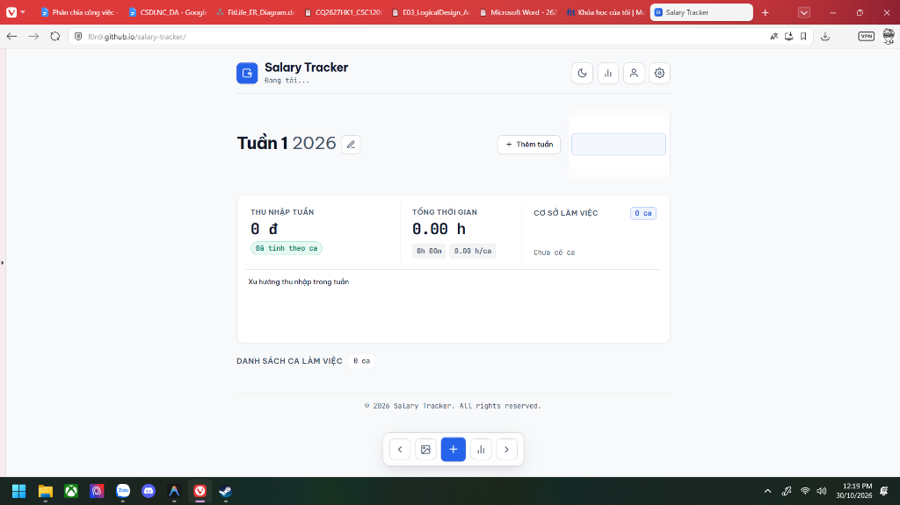
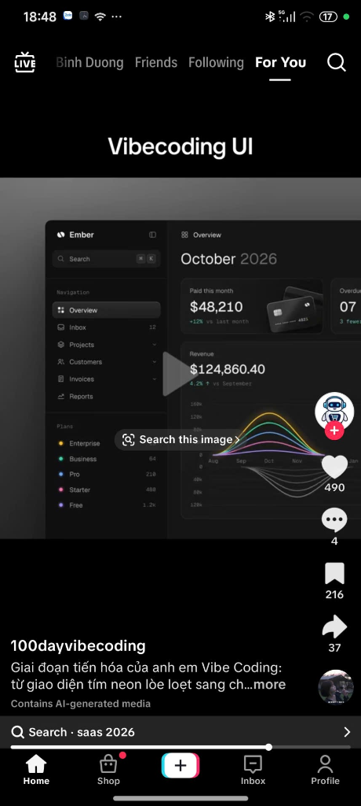

# Salary Tracker

[](https://aoe1920.github.io/salary-tracker/)
[](https://supabase.com)
[](https://supabase.com/docs/guides/auth)
[](https://developer.mozilla.org/)
[](LICENSE)

An offline-first, zero-build Progressive Web App (PWA) for shift scheduling, wage calculations, and personal financial tracking, backed by Supabase PostgreSQL with strict Row Level Security (RLS).

[**Live Demo →**](https://aoe1920.github.io/salary-tracker/)

---

## Preview

<p align="center">
  
</p>

<p align="center">
  
</p>

---

## Highlights

- **Smart Shift Detection & Overlap Calculation:** Automatic determination of morning, noon, and evening shifts based on working time overlap ratios, with tie-breaking logic.
- **Precision Wage Engine:** Accurate computation of base hourly rates, overnight shifts crossing midnight, overtime multipliers, fixed allowances, and deductions.
- **Multi-Workplace Management:** Individual workplace rate configs, custom color coding, and quick workplace switching.
- **Enterprise-Grade Authentication:** Dual sign-in with clean usernames or email, Google OAuth 2.0 PKCE, account identity linking, and self-service password recovery.
- **Security by Design:** Database-level Row Level Security (RLS) policies guaranteeing complete tenant data isolation (`auth.uid() = user_id`).
- **Offline-First PWA:** Service Worker Cache API with optimistic local persistence and seamless automatic cloud synchronization on reconnection.
- **Export & Share:** High-resolution HTML5 Canvas payslip generator with 1-click clipboard image copy, and multi-week CSV data export.
- **Refined UX & Micro-Interactions:** Smooth hardware-accelerated animations, iOS frosted-glass bottom dock, SVG avatar system, and non-intrusive toast notifications.

---

## Tech Stack

- **Frontend Core:** Vanilla ES2022 JavaScript (ES Modules), zero build tools required.
- **Styling:** Modular CSS3 with custom properties, responsive grid/flexbox, and light/dark theme variables.
- **Backend & Auth:** Supabase Cloud (PostgreSQL 15, Auth GoTrue, Realtime PostgreSQL Changes).
- **Offline PWA:** Service Worker Cache Storage API, Web App Manifest.
- **Icons & Avatars:** Handcrafted SVG icons and curated vector illustrations from [alohe/avatars](https://github.com/alohe/avatars).

---

## Architecture

```text
salary-tracker/
├── assets/
│   ├── avatars/        # Curated avatar illustrations (alohe/avatars)
│   └── icons/          # PWA app icons & favicon
├── css/
│   ├── base.css        # Design tokens, reset & typography
│   ├── components.css  # Buttons, cards, header & navigation pills
│   └── modals.css      # Modal dialogs, toast notifications & forms
├── docs/
│   ├── screenshots/    # Application preview illustrations
│   ├── templates/      # Password recovery email HTML template
│   ├── DESIGN.md       # Visual design specification
│   └── PRODUCT.md      # Product requirement document
├── js/
│   ├── services/
│   │   └── supabase.js # Supabase client, auth state & cloud sync
│   ├── ui/
│   │   ├── avatars.js  # Avatar selection & randomizer
│   │   ├── canvas-slip.js # HTML5 Canvas payslip generator
│   │   ├── chart.js    # Interactive financial analytics
│   │   ├── dialog.js   # Accessible dialog boxes
│   │   ├── export.js   # CSV & JSON backup exporter
│   │   ├── haptic.js   # Mobile vibration feedback
│   │   ├── modals.js   # Modal orchestrator & forms
│   │   ├── select.js   # Accessible custom dropdowns
│   │   └── toast.js    # Adaptive toast notification engine
│   ├── vendor/         # Isolated third-party helper runtimes
│   ├── app.js          # Main application bootstrapper
│   ├── calculator.js   # Pure wage calculation & time diff engine
│   ├── config.js       # App constants & palette presets
│   ├── i18n.js         # Localization dictionary
│   ├── state.js        # Reactive central application store
│   └── theme.js        # Theme state & system preference listener
├── index.html          # Semantic HTML5 application shell
├── manifest.json       # Progressive Web App manifest
└── sw.js               # Offline-first Service Worker
```

---

## Quick Start

Run locally without any bundler or build step:

```bash
# 1. Clone the repository
git clone https://github.com/aoe1920/salary-tracker.git
cd salary-tracker

# 2. Serve static files with any local HTTP server
npx serve .
# Or using Python 3:
# python -m http.server 8080
```

Open `http://localhost:8080` in your browser.

---

## Database Setup

Execute the following script in your **Supabase SQL Editor**:

```sql
create table if not exists public.user_salary_data (
  user_id uuid references auth.users(id) on delete cascade primary key,
  username text,
  weeks jsonb not null default '[]'::jsonb,
  settings jsonb not null default '{}'::jsonb,
  updated_at timestamptz default timezone('utc'::text, now()) not null
);

alter table public.user_salary_data enable row level security;

create policy "Users can only manage their own salary data"
  on public.user_salary_data for all
  using (auth.uid() = user_id)
  with check (auth.uid() = user_id);

create or replace function public.delete_user()
returns void
language plpgsql
security definer
set search_path = public
as $$
begin
  delete from auth.users where id = auth.uid();
end;
$$;

grant execute on function public.delete_user() to authenticated;

create or replace function public.get_login_email(p_username text)
returns text
language plpgsql
security definer
set search_path = public
as $$
declare
  v_email text;
begin
  select u.email into v_email
  from auth.users u
  left join public.user_salary_data s on s.user_id = u.id
  where lower(s.username) = lower(p_username)
     or lower(u.raw_user_meta_data->>'username') = lower(p_username)
  limit 1;
  return v_email;
end;
$$;

grant execute on function public.get_login_email(text) to anon, authenticated;
```

---

## License

This project is licensed under the [MIT License](LICENSE).
