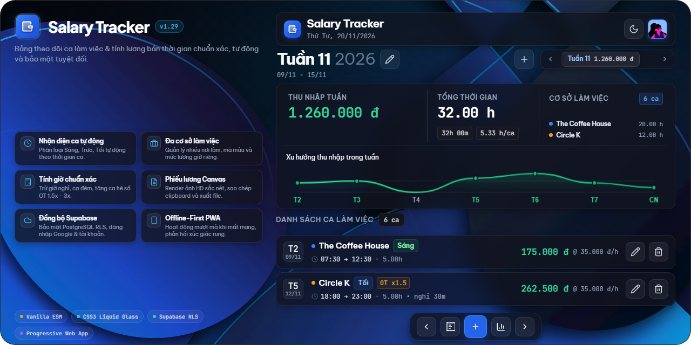

<div align="center">



# Salary Tracker

**Smart Shift Scheduling, Automated Wage Analytics & Instant Payslips**

An offline-first Progressive Web App for part-time workers, freelancers, and multi-job professionals to log shifts, compute overtime accurately, and export payslips in seconds.

[](https://aoe1920.github.io/salary-tracker/)
[](https://aoe1920.github.io/salary-tracker/)
[](https://supabase.com)
[](https://developer.mozilla.org/)
[](LICENSE)

<br/>

<a href="https://aoe1920.github.io/salary-tracker/">
  
</a>

</div>

---

## Key Features

- **Precision Shift & OT Engine:** Auto-classifies Morning/Afternoon/Evening shifts, handles overnight hours past midnight, break deductions, allowances, deductions, and `1.5x–3x` overtime multipliers.
- **Multi-Workplace & Rate Snapshots:** Color-coded workplaces with historical hourly rate snapshots so future wage raises never alter past week totals.
- **HD Payslips & Data Portability:** Render crisp HTML5 Canvas payslips (download PNG or copy to clipboard), export Excel-ready UTF-8 CSV reports, and backup/restore full JSON data.
- **Offline-First Cloud Sync:** Zero-latency local persistence with Service Worker caching and automatic Supabase PostgreSQL RLS sync with timestamp-aware conflict checks.

---

## Install as App (PWA)

- **iOS (Safari):** Tap **Share** → **Add to Home Screen** → **Add**.
- **Android (Chrome):** Open **Menu (⋮)** → **Install app**.
- **Desktop (Chrome / Edge):** Click the **Install** icon in the address bar.

---

## Tech Stack & Quickstart

Zero build tools or bundlers required — runs on native **ES2022 Modules**, **CSS3**, **HTML5 Canvas**, **Service Worker**, and **Supabase (PostgreSQL + GoTrue Auth + RLS)**.

```bash
git clone https://github.com/aoe1920/salary-tracker.git
cd salary-tracker
npx serve .
```

Open `http://localhost:3000` in your browser.

---

## Database Setup (Self-Hosting)

Run the following SQL in your Supabase SQL Editor to create the table, Row Level Security policy, and auth helper functions:

```sql
create table if not exists public.user_salary_data (
  user_id uuid references auth.users(id) on delete cascade primary key,
  username text,
  weeks jsonb not null default '[]'::jsonb,
  settings jsonb not null default '{}'::jsonb,
  updated_at timestamptz default timezone('utc'::text, now()) not null
);

alter table public.user_salary_data enable row level security;

create policy "Users can only manage their own salary data"
  on public.user_salary_data for all
  using (auth.uid() = user_id)
  with check (auth.uid() = user_id);

create or replace function public.delete_user()
returns void
language plpgsql
security definer
set search_path = public
as $$
begin
  delete from auth.users where id = auth.uid();
end;
$$;

grant execute on function public.delete_user() to authenticated;

create or replace function public.get_login_email(p_username text)
returns text
language plpgsql
security definer
set search_path = public
as $$
declare
  v_email text;
begin
  select u.email into v_email
  from auth.users u
  left join public.user_salary_data s on s.user_id = u.id
  where lower(s.username) = lower(p_username)
     or lower(u.raw_user_meta_data->>'username') = lower(p_username)
  limit 1;
  return v_email;
end;
$$;

grant execute on function public.get_login_email(text) to anon, authenticated;
```

---

## License

Licensed under the [MIT License](LICENSE).
