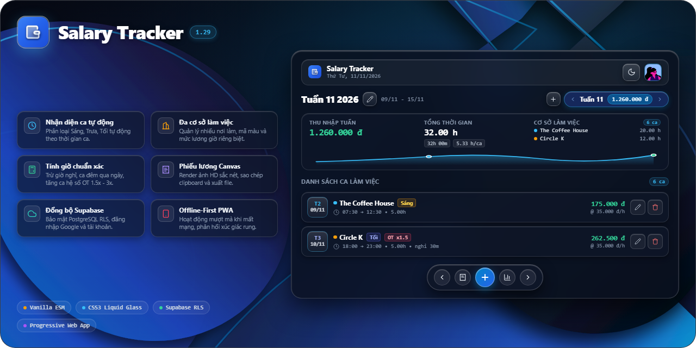

<div align="center">



# Salary Tracker

**Ứng dụng tính lương ca và theo dõi tài chính cá nhân thế hệ mới**

[](https://aoe1920.github.io/salary-tracker/)
[](https://github.com/aoe1920/salary-tracker/releases)
[](https://aoe1920.github.io/salary-tracker/)
[](https://supabase.com)
[](https://developer.mozilla.org/)
[](LICENSE)

<p align="center">
  <a href="https://aoe1920.github.io/salary-tracker/"><strong>Mở ứng dụng</strong></a> •
  <a href="README.md">English</a>
</p>

</div>

---

Salary Tracker là ứng dụng web tiến bộ (PWA) hỗ trợ theo dõi ca làm, tính lương chuẩn xác và quản lý thu nhập đa cơ sở, hoạt động ngoại tuyến mượt mà và đồng bộ đám mây bảo mật.

## Tính năng nổi bật

- **Nhận diện ca thông minh:** Tự động phân loại Ca Sáng, Chiều, Tối theo thời gian thực và tự sắp xếp ca theo trình tự thời gian.
- **Tính lương chuẩn xác:** Tự động trừ giờ nghỉ, xử lý ca xuyên đêm qua mốc 00:00, hỗ trợ hệ số tăng ca (1x, 1.5x, 2x, 3x), phụ cấp và giảm trừ.
- **Quản lý đa nơi làm việc:** Không giới hạn số lượng cơ sở với đơn giá giờ riêng và mã màu trực quan.
- **Phiếu chấm công Canvas:** Kết xuất phiếu lương độ nét cao, sao chép 1 chạm vào bộ nhớ tạm để gửi tin nhắn hoặc xuất tệp PNG, CSV, JSON.
- **Đồng bộ đám mây:** Xác thực qua Username, Email hoặc Google OAuth PKCE, bảo mật cấp hàng (Row Level Security) với Supabase PostgreSQL.
- **Trải nghiệm PWA:** Hoạt động ngoại tuyến qua Service Worker Cache, phản hồi rung haptic và thanh dock Liquid Glass hiện đại.

## Công nghệ sử dụng

- **Frontend:** Vanilla JavaScript (ES2022 Modules), CSS3 Variables
- **Backend:** Supabase (PostgreSQL 15, GoTrue Auth, RLS)
- **Lưu trữ và PWA:** Service Worker API, Cache Storage
- **Đồ họa:** HTML5 Canvas API, SVG thuần

## Khởi chạy cục bộ

Không cần cài đặt công cụ biên dịch hay đóng gói:

```bash
git clone https://github.com/aoe1920/salary-tracker.git
cd salary-tracker
npx serve .
```

Mở trình duyệt tại `http://localhost:3000` (hoặc `http://localhost:8080`).

## Cài đặt PWA

- **iOS (Safari):** Nhấn nút Chia sẻ -> Thêm vào MH chính.
- **Android (Chrome):** Nhấn Menu ba chấm -> Cài đặt ứng dụng.
- **Máy tính (Chrome/Edge):** Nhấn biểu tượng Cài đặt trên thanh địa chỉ.

## Cấu hình Cơ sở dữ liệu Supabase

Thực thi trong SQL Editor của Supabase:

```sql
create table if not exists public.user_salary_data (
  user_id uuid references auth.users(id) on delete cascade primary key,
  username text,
  weeks jsonb not null default '[]'::jsonb,
  settings jsonb not null default '{}'::jsonb,
  updated_at timestamptz default timezone('utc'::text, now()) not null
);

alter table public.user_salary_data enable row level security;

create policy "Users can only manage their own salary data"
  on public.user_salary_data for all
  using (auth.uid() = user_id)
  with check (auth.uid() = user_id);

create or replace function public.delete_user()
returns void
language plpgsql
security definer
set search_path = public
as $$
begin
  delete from auth.users where id = auth.uid();
end;
$$;

grant execute on function public.delete_user() to authenticated;

create or replace function public.get_login_email(p_username text)
returns text
language plpgsql
security definer
set search_path = public
as $$
declare
  v_email text;
begin
  select u.email into v_email
  from auth.users u
  left join public.user_salary_data s on s.user_id = u.id
  where lower(s.username) = lower(p_username)
     or lower(u.raw_user_meta_data->>'username') = lower(p_username)
  limit 1;
  return v_email;
end;
$$;

grant execute on function public.get_login_email(text) to anon, authenticated;
```

## Giấy phép

[MIT](LICENSE)
